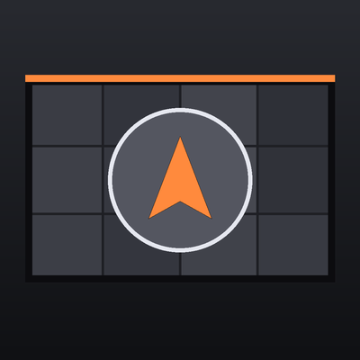
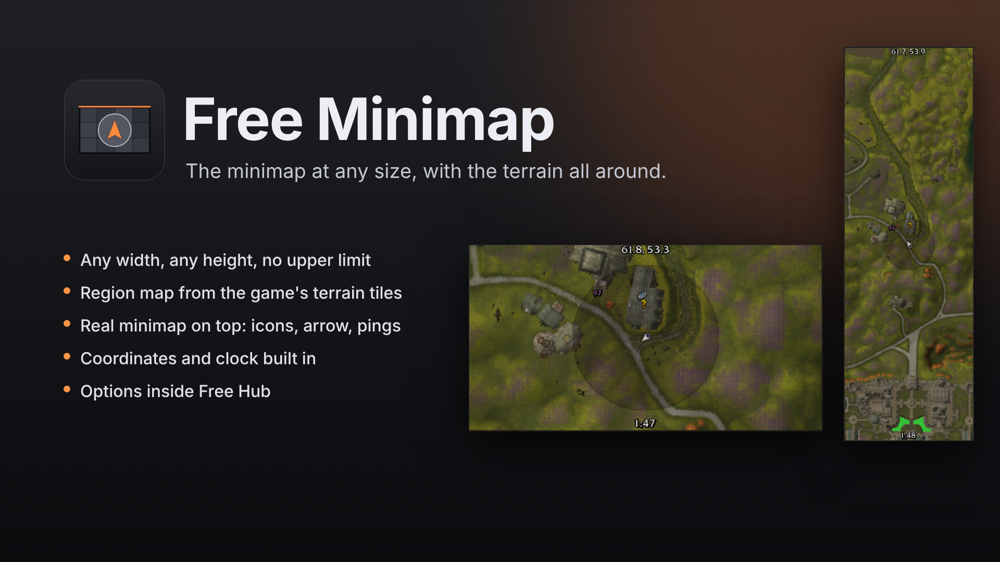
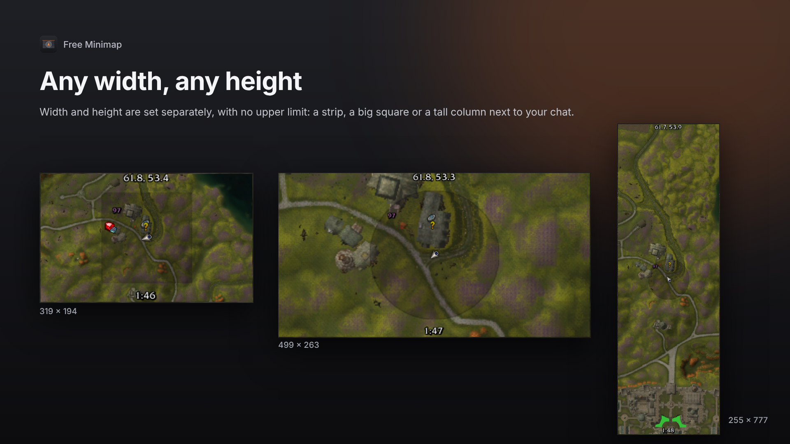
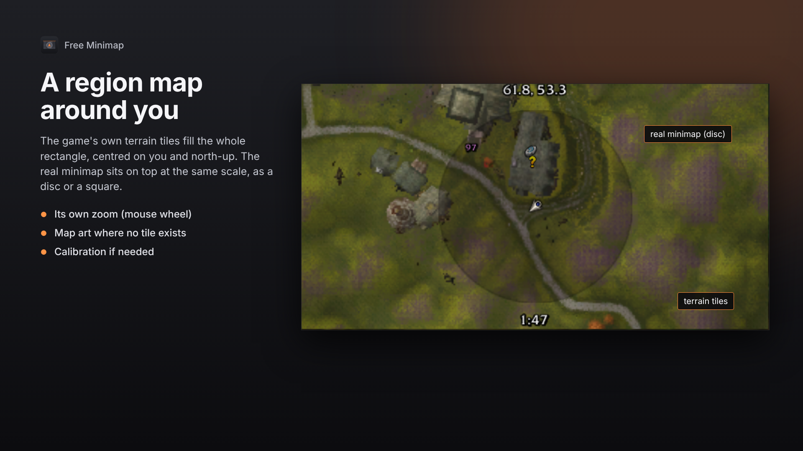
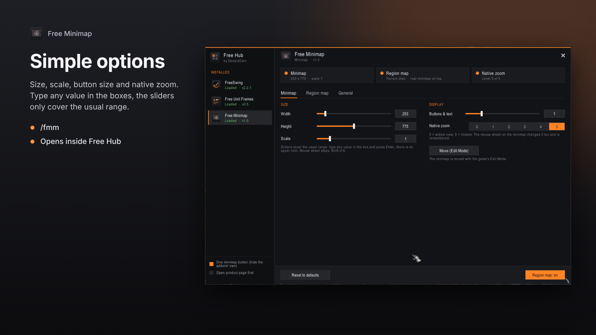
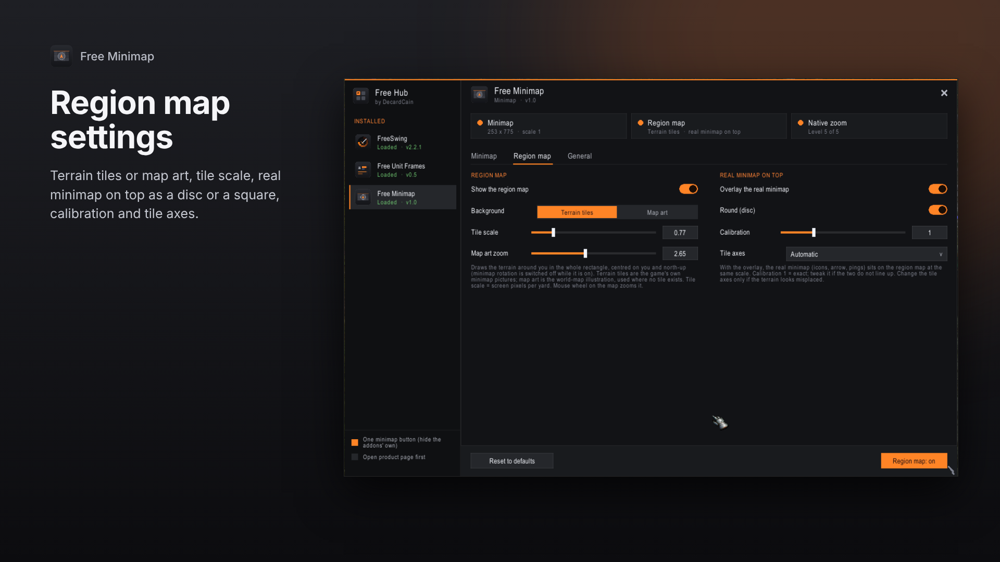

<h1 align="center">Free Minimap</h1>

A rectangular minimap of any size, with a region map drawn from the game's own terrain tiles around you.

<a href="https://www.curseforge.com/wow/addons/freeminimap"><b>Download on CurseForge</b></a> · version <b>1.7.1</b> · WoW Forever (1.60.1) · <code>/fmm</code>

## Screenshots

<table>
<tr>
<td width="50%" valign="top"> <b>Any width, any height</b> A strip, a big square or a tall column: no upper limit.</td>
<td width="50%" valign="top"> <b>Region map</b> The game&#x27;s terrain tiles fill the whole rectangle; the real minimap sits on top at the same scale.</td>
</tr>
<tr>
<td width="50%" valign="top"> <b>Options</b> Size, scale, button size and native zoom.</td>
<td width="50%" valign="top"> <b>Region map settings</b> Tiles or map art, tile scale, disc or square, calibration.</td>
</tr>
</table>

**The minimap at the size you want, with the terrain all around you.**

Free Minimap turns the minimap into a rectangle whose width and height you set separately, with no upper limit: a wide strip on an ultrawide screen, a big square, or a tall column next to your chat. Coordinates sit at the top, the clock at the bottom.

## Region map

The native minimap only ever shows a few hundred yards around you: making it bigger just magnifies the picture. The **region map** fills the whole rectangle with the game's own minimap terrain tiles, centred on you and north-up, with its own zoom (mouse wheel). Where no tile exists, the world-map illustration is used instead.

The **real minimap** can stay on top of it, as a disc or a square, at exactly the same scale, so quest icons, the player arrow, gathering nodes and pings stay where they belong.

Beyond the real minimap, the region map shows **your quests** (with their objectives in the tooltip and the outline of their areas, as on the minimap) and the **icons of other addons**: Questie, RestedXP (next steps included), TomTom, gatherers… every addon using HereBeDragons. Icons that point the way float on the edge of the region map.

| Setting | What it does |
|---|---|
| **Width / Height** | Set separately. Sliders cover the usual range; type any value in the box, there is no upper limit. |
| **Scale** | Size of the whole minimap. |
| **Buttons & text** | Size of the buttons and texts around the minimap, independent from its size. |
| **Native zoom** | 0 (widest) to 5 (closest), remembered per character. |
| **Region map** | Terrain tiles or map art, tile scale (screen pixels per yard), map art zoom. |
| **Quests of the log** | Your quests and their areas on the whole region map; click one to track it. |
| **Icons of other addons** | Questie, RestedXP, TomTom… icons beyond the real minimap, with their tooltips. |
| **Real minimap on top** | On or off, disc or square, fine calibration if the two layers don't line up. |
| **Tile axes** | Automatic; change it only if the terrain looks misplaced. |
| **Elements around the map** | Zone, coordinates, clock, tracking, calendar, day/night, mail, difficulty, addon compartment and zoom: place each one, scale it, and show it always, on hover or never. |
| **Profiles** | Each character gets its own profile; switch, copy, export or import them. |

Place the minimap yourself (X / Y, or unlock and drag it, kept safe in combat) or leave it to the game's Edit Mode.

## Commands

- `/fmm` — options
- `/fmm region` — region map on / off
- `/fmm axes 0-8` — tile axes (0 = automatic)
- `/fmm reset` — back to defaults

## Free Hub

Free Minimap works on its own. With **Free Hub** installed, its options open inside the hub next to the other Free addons, and a single minimap button replaces theirs.

## Credits

- Based on **DejaMinimap** (by Dejablue, Bõb, Ertkal and Eurytus), with permission.
- Minimap terrain tile data from **OpenMap** (MIT licence).

## The Free suite

Addons for WoW Forever that share the same look, profiles and a single minimap button through Free Hub.

| | Addon | |
|---|---|---|
|  | **[Free Hub](https://github.com/DecardCainSuite/FreeHub)** — All the Free addons in one window: options side by side, product pages with gallery, and a single minimap button. | [CurseForge](https://www.curseforge.com/wow/addons/free-hub) |
|  | **[Free Unit Frames](https://github.com/DecardCainSuite/FreeUnitFrames)** — Fully customisable unit frames for player, target, focus, party, raid and bosses, with an ElvUI-style preset in one click. | [CurseForge](https://www.curseforge.com/wow/addons/freeunitframes) |
|  | **[Free Bars](https://github.com/DecardCainSuite/FreeBars)** — Up to 9 action bars, laid out as a grid or an arc, with mouseover fade, paging and a clean flat look. | [CurseForge](https://www.curseforge.com/wow/addons/freebars) |
|  | **[Free Swing](https://github.com/DecardCainSuite/FreeSwing)** — Swing timers for main hand, off hand and ranged, at exactly the size and style you want. | [CurseForge](https://www.curseforge.com/wow/addons/freeswing) |
|  | **[Free Minimap](https://github.com/DecardCainSuite/FreeMinimap)** (this one) — A rectangular minimap of any size, with a region map drawn from the game's own terrain tiles around you. | [CurseForge](https://www.curseforge.com/wow/addons/freeminimap) |
|  | **[Free Guild](https://github.com/DecardCainSuite/FreeGuild)** — Guild roster and rank tool for guild masters and officers: filters, bulk ranks, rules that promote for you, stats, raid rosters with attendance, guild info and notes. | [CurseForge](https://www.curseforge.com/wow/addons/freeguild) |
|  | **[Free LFG](https://github.com/DecardCainSuite/FreeLFG)** — The group finder as a compact, sortable table: leader, roles, free slots, one-click whisper from a template, and live filters you write yourself. | [CurseForge](https://www.curseforge.com/wow/addons/freelfg) |
|  | **[Free Auras](https://github.com/DecardCainSuite/FreeAuras)** — Ready-made ForeverAuras packs, installed in one click: a clean rogue column with combo marks, energy, poisons, buffs and bleeds on one time scale, and cooldowns. | [CurseForge](https://www.curseforge.com/wow/addons/free-auras) |

## Changelog

What is new in the current version: [CHANGELOG.md](CHANGELOG.md). Full history: [CHANGELOG-history.md](CHANGELOG-history.md).

## Repository layout and releases

- The repository root is the addon folder (`FreeMinimap/`), as installed in `Interface\AddOns`.
- `curseforge/` holds the CurseForge page: `description.md` (fields, gallery captions, description) and `images/` (logo, gallery, social preview). It is not shipped in the addon zip.
- `CHANGELOG.md` holds the notes of the version being prepared; they are sent to CurseForge as the file's changelog.
- Releasing: bump `## Version` in `FreeMinimap.toc`, write `CHANGELOG.md`, then publish a GitHub release named `v<version>`. GitHub Actions packages the addon with the [BigWigs packager](https://github.com/BigWigsMods/packager) and uploads it to CurseForge and to the GitHub release.

Bug reports and ideas are welcome in the issues or in the CurseForge comments.
